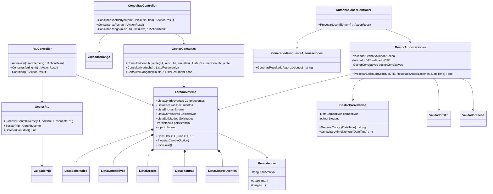
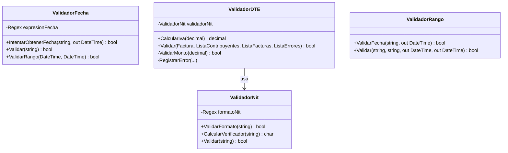
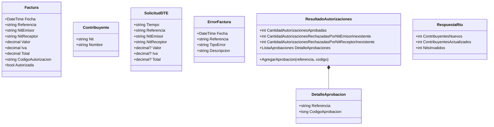
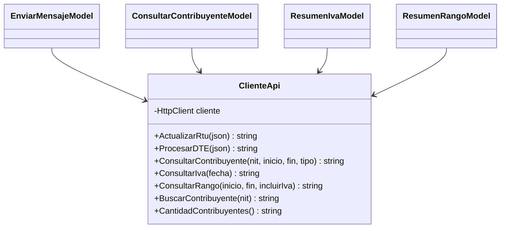
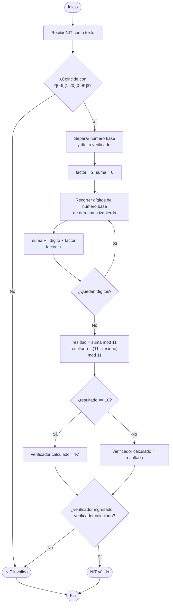
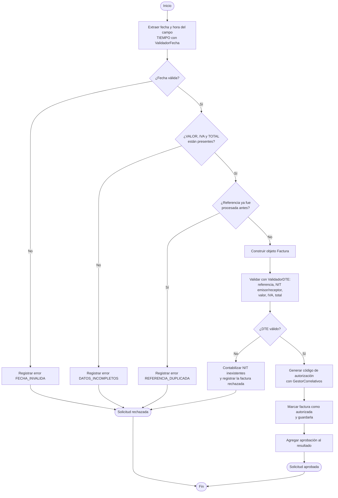
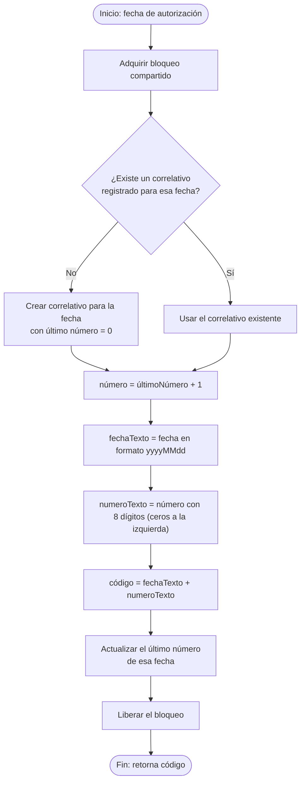
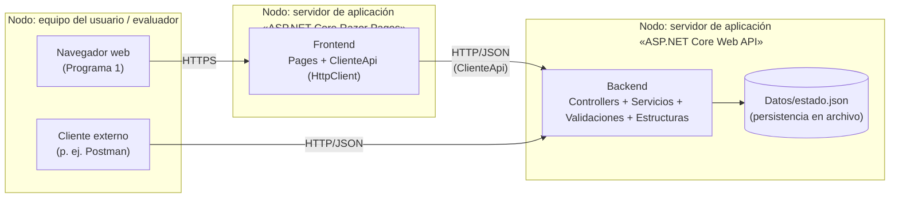

# Diagramas — Proyecto 3: API de autorización de DTE (SAT)
 
Diagramas generados a partir del código del repositorio `IPC2_Proy03_202602_202503481`
(commit `7657cb4`). Pensados como apéndice del ensayo (fuera de las 4–7 páginas de contenido).
 
## 1. Diagrama de clases
 
### 1.1 Controladores y servicios (Backend)
 

 
### 1.2 Validaciones
 

 
### 1.3 Modelos (DTOs)
 

 
### 1.5 Frontend
 

 
---
 
## 2. Diagramas de actividades
 
### 2.1 Validación del NIT (algoritmo módulo 11)
 

 
### 2.2 Procesamiento de una solicitud de autorización DTE
 

 
### 2.3 Generación del correlativo diario
 

 
---
 
## 3. Diagrama de despliegue
 

 